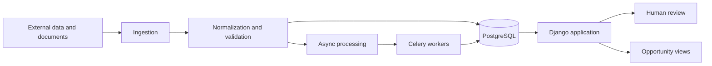
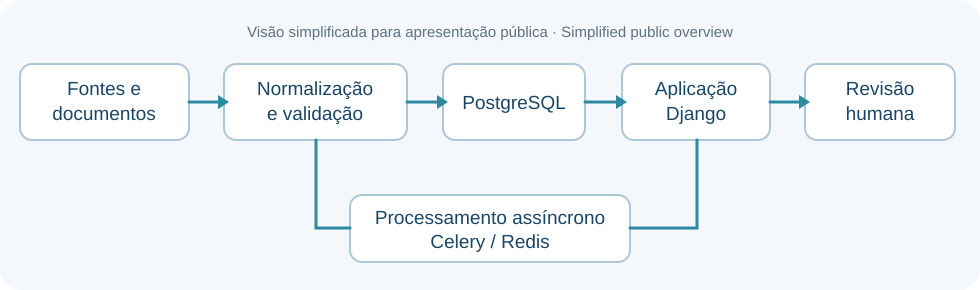

# SeuLeilão

[🇧🇷 Português](README.md) | 🇺🇸 **English**

🌐 **[Project website](https://breno3b.github.io/seu-leilao-showcase/en/)**

**Python/Django platform for real estate auction analysis, opportunity tracking, data processing, and decision support.**

SeuLeilão is a personal software project focused on organizing the analysis of real estate auction opportunities into a structured, traceable workflow.

The project explores how software can support the collection, normalization, validation, enrichment and review of information that is usually fragmented across different sources and documents.

> This repository is a public technical showcase of the project. It presents the product concept, architecture and engineering practices at a high level.

## What the project addresses

Real estate auction analysis often involves combining information from multiple sources, reviewing documents, tracking changes, resolving inconsistencies and comparing opportunities before a decision can be made.

SeuLeilão is being designed to support this workflow by:

- organizing multiple opportunities in parallel;
- preserving provenance and history of collected information;
- separating automated processing from human review;
- surfacing incomplete, conflicting or outdated information;
- supporting repeatable analysis instead of one-off manual checks;
- providing a technical foundation for future decision-support features.

## Current technology stack

- **Python**
- **Django**
- **PostgreSQL**
- **Celery**
- **Redis**
- **Django Templates / htmx**
- **Docker / Docker Compose**
- **pytest / pytest-django**

The current architecture is a **modular monolith with asynchronous workers** for long-running or reprocessable tasks.

## Engineering principles

The project is being developed around a few core principles:

- **Traceability** — important data should retain origin and history.
- **Incremental processing** — existing records are enriched instead of unnecessarily rebuilt.
- **Explicit uncertainty** — missing or conflicting information should remain visible rather than being silently guessed.
- **Human-in-the-loop** — decisions that require judgment can be routed for review.
- **Idempotency** — reprocessing should be safe where possible.
- **Testability** — business behavior and processing flows are covered by automated tests.
- **Modularity** — domain boundaries remain explicit even inside a monolithic deployment.

## High-level architecture



The application keeps the transactional core in Django/PostgreSQL while asynchronous work is delegated to Celery workers through Redis.

More detail is available in [Architecture Overview](docs/en/architecture-overview.md).

## Development approach

The project follows an iterative path from domain understanding to implementation:

```text
Problem
  → process
  → domain
  → data
  → rules
  → requirements
  → architecture
  → implementation
  → tests
  → validation
```

Architecture decisions are documented internally with ADRs, and the project evolves through small vertical slices that can be validated before broader expansion.

## AI-assisted development

Generative AI is used as a development tool for activities such as:

- refining requirements;
- exploring implementation alternatives;
- generating and refactoring code;
- improving documentation;
- proposing tests;
- reviewing technical solutions.

Generated output is treated as material to be reviewed and validated, not as an authoritative source of truth.

See [AI-assisted Development](docs/en/ai-assisted-development.md).

## Engineering challenges explored

The project has required work around:

- heterogeneous and changing data sources;
- document acquisition and processing;
- asynchronous workflows;
- provenance and versioning;
- incomplete and conflicting data;
- retryable processing;
- human review queues;
- deterministic rules alongside AI-assisted processing;
- keeping product and engineering decisions auditable.

See [Engineering Challenges](docs/en/engineering-challenges.md).

## My role in the project

I define the problem, organize requirements and priorities, guide the project's evolution, and assess results. Generative AI is used extensively to support code production, documentation, and testing.

My work includes guiding implementation, evaluating proposed solutions, following validation, and continuing to strengthen my Python and backend engineering skills. AI-assisted implementation should not be confused with writing every line of code manually.

## Evidence and development stage

**In development:** personal Python/Django platform with modular architecture, relational persistence, and asynchronous processing described in the technical documentation.

**Engineering goals and principles:** traceability, explicit uncertainty, incremental processing, human review, and test-driven evolution.

**Not demonstrated in this showcase:** public availability of the operational product, production usage results, performance metrics, or demos using real data. A described workflow should not be interpreted as proof that every step is fully implemented.



## Project status

SeuLeilão is under active development as a personal project and is being evolved toward an operational product.

The public showcase will be updated as the project reaches milestones that can be presented without exposing implementation-specific or product-sensitive details.

## Author

**Breno Rodrigues Magalhães**

- [GitHub](https://github.com/Breno3B)
- [LinkedIn](https://www.linkedin.com/in/brenorm/)
