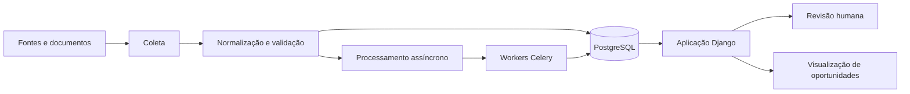

# SeuLeilão

🇧🇷 **Português** | [🇺🇸 English](README.en.md)

**Plataforma em Python/Django para análise de imóveis em leilão, acompanhamento de oportunidades, processamento de dados e apoio à decisão.**

O **SeuLeilão** é um projeto pessoal de software voltado a organizar a análise de oportunidades de imóveis em leilão em um fluxo estruturado e rastreável.

O projeto explora como o software pode apoiar a coleta, normalização, validação, enriquecimento e revisão de informações dispersas em diferentes fontes e documentos.

> Este repositório apresenta uma visão técnica pública do projeto. O produto e sua implementação são desenvolvidos separadamente.

🌐 **[Conheça a apresentação do projeto](https://breno3b.github.io/seu-leilao-showcase/)**

## Problema abordado

Analisar imóveis em leilão exige reunir informações de fontes diferentes, revisar documentos, acompanhar alterações, resolver inconsistências e comparar oportunidades.

O SeuLeilão busca apoiar esse trabalho por meio de:

- organização de múltiplas oportunidades;
- preservação da origem e do histórico dos dados;
- separação entre processamento automatizado e revisão humana;
- identificação de informações incompletas, conflitantes ou desatualizadas;
- análises reproduzíveis e processos consistentes;
- uma base técnica para futuras funcionalidades de apoio à decisão.

## Tecnologias

**Python · Django · PostgreSQL · Celery · Redis · Django Templates / htmx · Docker / Docker Compose · pytest / pytest-django**

A arquitetura atual combina um **monólito modular** com tarefas assíncronas para trabalhos demorados ou que precisem de reprocessamento.

## Princípios de engenharia

- **Rastreabilidade:** preservar origem e histórico de informações importantes.
- **Processamento incremental:** enriquecer registros existentes sem refazer etapas desnecessárias.
- **Incerteza explícita:** não presumir respostas diante de dados ausentes ou conflitantes.
- **Revisão humana:** encaminhar decisões que exigem julgamento.
- **Idempotência:** permitir reprocessamentos seguros sempre que possível.
- **Testabilidade:** proteger comportamentos por meio de testes automatizados.
- **Modularidade:** manter limites claros entre responsabilidades.

## Arquitetura em alto nível



Saiba mais em [Visão geral da arquitetura](docs/pt/architecture-overview.md).

## Abordagem de desenvolvimento

```text
Problema → processo → domínio → dados → regras
→ requisitos → arquitetura → implementação → testes → validação
```

O projeto utiliza decisões arquiteturais documentadas internamente e evolui de maneira iterativa.

## Desenvolvimento assistido por IA

A IA generativa apoia a definição de requisitos, a exploração de alternativas, a geração e refatoração de código, a documentação e a criação e revisão de testes. As propostas geradas precisam ser analisadas e validadas.

Leia [Desenvolvimento assistido por IA](docs/pt/ai-assisted-development.md).

## Desafios de engenharia

O projeto explora fontes heterogêneas, documentos, processamento assíncrono, histórico dos dados, informações conflitantes, reprocessamento e revisão humana.

Leia [Desafios de engenharia](docs/pt/engineering-challenges.md).

## Meu papel no projeto

Sou responsável por definir o problema, organizar requisitos e prioridades, conduzir a evolução do projeto e avaliar resultados. O desenvolvimento utiliza IA generativa de maneira intensiva para apoiar a produção de código, documentação e testes.

Meu trabalho inclui orientar implementações, avaliar propostas, acompanhar validações e continuar aprofundando meus conhecimentos em Python e engenharia backend. O uso de IA não representa autoria manual integral do código.

## Evidências e estágio

**Em desenvolvimento:** plataforma pessoal baseada em Python/Django, com arquitetura modular, persistência relacional e processamento assíncrono descritos na documentação.

**Princípios e objetivos do projeto:** rastreabilidade, tratamento explícito de incertezas, processamento incremental, revisão humana e evolução guiada por testes.

**Ainda não apresentados neste showcase:** disponibilidade pública do produto, resultados de uso em produção, métricas de desempenho e demonstrações com dados reais. A descrição de um fluxo não deve ser interpretada como garantia de que todas as suas etapas estejam concluídas.


## Estado atual

Projeto pessoal em desenvolvimento contínuo, com evolução planejada para uma solução operacional. O showcase será atualizado conforme existirem marcos adequados à apresentação pública.

## Autor

**Breno Rodrigues Magalhães** · [GitHub](https://github.com/Breno3B) · [LinkedIn](https://www.linkedin.com/in/brenorm/)
