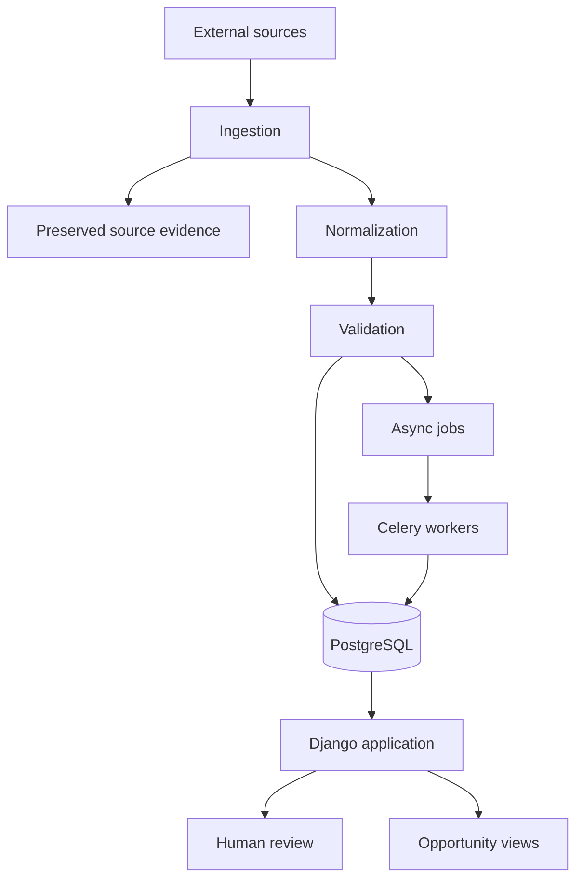

# Architecture Overview

## Architectural style

SeuLeilão currently follows a **modular monolith** architecture complemented by **asynchronous workers**.

This choice keeps the operational model simple while allowing long-running, retryable or reprocessable work to happen outside the synchronous request cycle.

## Core components

### Django application

Django provides the main application runtime and supports domain-oriented application modules, persistence and transactions, migrations, internal administration, server-rendered interfaces, and application services.

### PostgreSQL

PostgreSQL is the authoritative transactional data store.

It persists normalized information, processing state, provenance and historical records needed for traceability.

### Celery and Redis

Celery is used for asynchronous jobs, with Redis acting as the initial message broker.

This allows potentially expensive or failure-prone operations to be retried and processed independently of user requests.

### Server-rendered UI

The current frontend strategy favors Django Templates and htmx.

The goal is to validate workflows and user experience without introducing a separate SPA and API layer before there is a concrete need for them.

## High-level flow

## Design principles

### Preserve evidence

Source information and historical state should remain traceable instead of being silently overwritten.

### Process incrementally

When an opportunity has already been seen, the system should enrich it with new information instead of repeating expensive work without reason.

### Keep uncertainty explicit

Missing, stale or conflicting data is represented as an unresolved condition rather than automatically converted into a convenient value.

### Support human review

Not every decision should be automated. The system can surface cases that require judgment and preserve the result of that review.

### Separate business state from processing state

Commercial or domain state, processing issues, readiness for a given workflow and human decisions are treated as distinct concepts.

### Make asynchronous work safe

Background tasks are designed with retryability, idempotency and traceability in mind.

## Why not microservices?

The domain and product are still evolving. A distributed architecture would add deployment, consistency and observability costs before there is evidence that independent services are necessary.

Explicit module boundaries preserve an evolution path if future scale or operational requirements justify separation.
