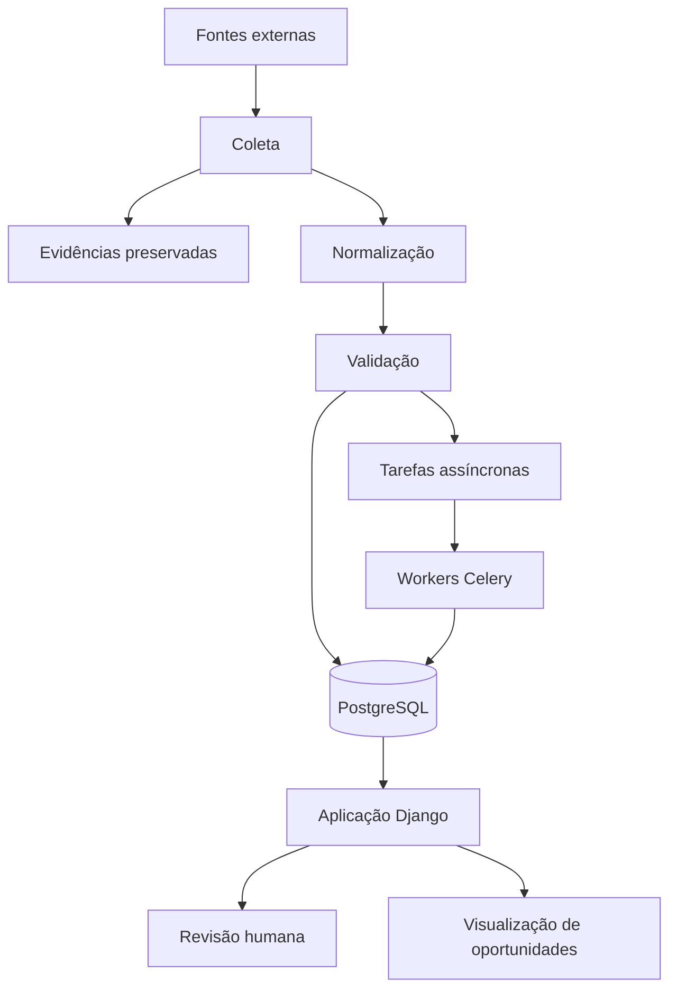

# Visão geral da arquitetura

[🇧🇷 Português](architecture-overview.md) | [🇺🇸 English](../en/architecture-overview.md)

## Estilo arquitetural

O SeuLeilão utiliza um **monólito modular** combinado com **workers assíncronos**. Essa escolha reduz a complexidade operacional enquanto permite executar tarefas demoradas, repetíveis ou sujeitas a falhas fora do ciclo de requisições HTTP.

## Componentes principais

### Aplicação Django

O Django oferece módulos de aplicação orientados ao domínio, persistência, transações, migrações, administração interna, interfaces renderizadas no servidor e serviços de aplicação.

### PostgreSQL

O PostgreSQL é o armazenamento transacional principal. Nele ficam informações normalizadas, estados de processamento, origem dos dados e históricos importantes para a rastreabilidade.

### Celery e Redis

O Celery executa tarefas assíncronas; o Redis atua como broker inicial. Operações potencialmente demoradas ou sujeitas a falhas podem ser repetidas sem bloquear as requisições do usuário.

### Interface renderizada no servidor

A estratégia atual prioriza Django Templates e htmx, permitindo validar fluxos de uso antes de adicionar uma aplicação SPA e uma camada de API separadas.

## Fluxo simplificado

## Princípios de projeto

**Preservação de evidências:** os dados das fontes e seu histórico devem continuar rastreáveis.

**Processamento incremental:** informações novas enriquecem oportunidades existentes sem refazer trabalho desnecessariamente.

**Incerteza explícita:** dados ausentes, desatualizados ou conflitantes permanecem identificáveis.

**Revisão humana:** decisões que demandam julgamento podem ser encaminhadas e registradas.

**Separação de estados:** estados do domínio, do processamento, de prontidão e das decisões humanas são tratados como conceitos distintos.

**Segurança do processamento assíncrono:** tarefas são pensadas para retentativas, idempotência e rastreabilidade.

## Por que não microserviços?

O domínio e o produto continuam em evolução. Uma arquitetura distribuída acrescentaria custos de implantação, consistência e observabilidade antes de existir justificativa concreta para essa complexidade. A modularidade mantém aberta uma futura evolução arquitetural.
